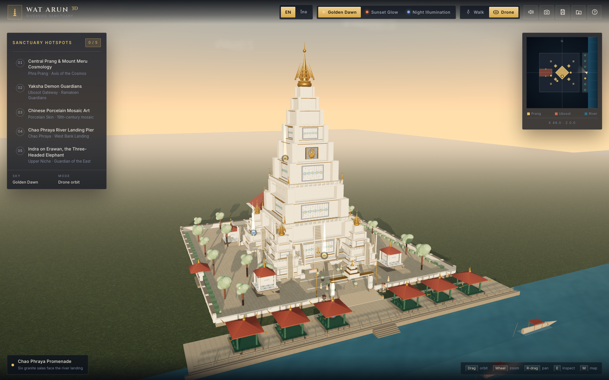

# Wat Arun 3D — Virtual Riverside Sanctuary & Walkthrough Studio

**วัดอรุณ 3D — ศาสนสถานเสมือนจริงริมแม่น้ำและสตูดิโอเดินชม**

An interactive, first-person and drone walkthrough of **Wat Arun Ratchawararam** — the Temple of Dawn on the west bank of the Chao Phraya River in Bangkok — built with vanilla HTML5, CSS3, ES6 JavaScript and Three.js. Every wall, tier, guardian, sala, ripple of water and chime is generated procedurally in the browser: there are no external models, photographs or audio files.

[](https://somphol.github.io/wat-arun-3d/)

**Live demo:** <https://somphol.github.io/wat-arun-3d/>

---

## Contents

- [Why this exists](#why-this-exists)
- [Feature tour](#feature-tour)
- [The five hotspots](#the-five-hotspots)
- [Lighting presets](#lighting-presets)
- [Controls](#controls)
- [The tour journal](#the-tour-journal)
- [How the sanctuary is modelled](#how-the-sanctuary-is-modelled)
- [Sound design](#sound-design)
- [Project structure](#project-structure)
- [Run it locally](#run-it-locally)
- [Verification](#verification)
- [Accessibility & performance](#accessibility--performance)
- [Cultural notes](#cultural-notes)
- [Credits](#credits)
- [License](#license)

---

## Why this exists

Wat Arun is one of the most photographed monuments in Southeast Asia, yet most digital tours stop at a handful of flat photographs. This project is an attempt to make the *place* walkable: to let you climb the river landing, pass between the six granite salas, walk under the gate, look up at the porcelain-skinned prang, and hear the river and the wind chimes while you read about what you are seeing — in English or in Thai.

The whole experience is a single static site. Open `index.html` from a web server and it runs.

| | |
| --- | --- |
| Central prang | ~76 m procedural tower, three circumambulatory galleries, four steep pilgrim stairs, gilded finial |
| Courtyard | 4 satellite prangs · 4 corner mondops · ubosot with two yaksha guardians · 6 riverside salas |
| Interactivity | 5 bilingual hotspots with narration, 3 lighting presets, photo journal, JSON export/import |
| Navigation | Hold-and-drag 3D orbit (zoom + pan) or a first-person walk with collision + jump |
| Audio | Web Audio synthesised river, wind chimes, footsteps; SpeechSynthesis narration |

---

## Feature tour

### A courtyard you can walk

- **First-person walkthrough** with WASD / arrow keys, hold-and-drag look, `Shift` to sprint, `Space` to jump. The mouse is never captured unless you explicitly ask for immersive mouse look.
- **Collision detection** against the prang, satellite towers, mondops, ubosot, salas, trees, walls and the river boundary, with step-up handling for the terrace ramp and the gate.
- **Drone flyover** with OrbitControls: hold-and-drag to orbit, wheel to zoom, right-drag to pan, from river level to the finial. This is the default entry view.
- Switch modes from the HUD at any time; the walk position is preserved when you return from the drone.

### A bilingual sanctuary

Every piece of interface text, every hotspot title, description, quote, zone label, hint and toast is available in **English and Thai**. The toggle in the header (`EN / ไทย`) switches instantly, including the open hotspot card and the live mini-map labels. Narration follows the selected language using the device's own voice.

### Five educational hotspots

Floating gold markers hover at the five key places. Walk close and the card opens automatically; or click a marker, press `E` near it, or choose it from the hotspot list. Each card contains a title, Thai/English subtitle, three paragraphs of history and architectural lore, a pull quote, and a narration button.

### Three skies

Golden dawn, sunset glow and the Chao Phraya night illumination. Each preset interpolates sun colour and angle, sky gradient, fog, ambient and hemisphere light, water tint, cloud colour, exposure, stars and the warm floodlights on the prang — over roughly a second, so the change feels like time passing rather than a switch.

### A journal that survives the visit

Visits and photo bookmarks autosave to `localStorage`. The header save button (or **Save tour journal** in the field guide) downloads `watarun_3d_journal.json`, including visited hotspots, photo thumbnails, language and lighting settings, and the player position. **Load journal** restores it on any device.

### Built for the small screen too

The layout reflows at 960 px and 760 px: the hotspot list becomes a drawer, the drone/walk controls stay reachable, the mini-map moves to the top corner, and a four-way touch pad appears for walking. Touch drag looks around in first person; OrbitControls handles the drone.

---

## The five hotspots

| # | English | ไทย | Where |
| --- | --- | --- | --- |
| 01 | **Central Prang & Mount Meru Cosmology** | พระปรางค์ประธานกับจักรวาลวิทยาเขาพระสุเมรุ | East stair of the central prang |
| 02 | **Yaksha Demon Guardians** | ทวารบาลยักษ์แห่งอุโบสถ | Ubosot gate, between Thotsakan and Sahassa Deja |
| 03 | **Chinese Porcelain Mosaic Art** | ศิลปะการประดับกระเบื้องเคลือบจีน | Porcelain niche on the prang's south-west face |
| 04 | **Chao Phraya River Landing Pier** | ท่าเรือริมแม่น้ำเจ้าพระยา | The six-sala riverfront |
| 05 | **Indra on Erawan, the Three-Headed Elephant** | พระอินทร์ทรงช้างเอราวัณ | Upper east niche of the prang |

Each hotspot is also a waypoint on the mini-map: gold before your visit, green afterwards. Hovering a marker shows a *Read:* prompt; click it, choose it from the list, or press `E` near it.

---

## Lighting presets

| Preset | ไทย | What changes |
| --- | --- | --- |
| **Golden Dawn** | อรุโณทัย | Low warm sun over the river, peach horizon, long soft shadows, pale blue zenith |
| **Sunset Glow** | อัสดง | Deep orange sky, 4° sun, dramatic red-gold light, a warmer river |
| **Night Illumination** | วิจิตรเจ้าพระยา | Star field, cool moonlight, six warm floodlights on the prang, glowing lanterns and a gold reflection path on the water |

The lighting rig uses a shadow-casting directional sun, hemisphere and ambient fill, six spotlights, three promenade point lights, an environment map generated from the sky with `PMREMGenerator`, and a custom sky shader with a sun disc and procedural stars.

---

## Controls

Navigation never captures the mouse on entry. The default **Explore** view is a normal 3D camera: hold the left button and drag to orbit, scroll to zoom, and right-drag to pan. **Walk** mode uses the same hold-and-drag vocabulary to look around, with WASD to move and the wheel to zoom. Continuous pointer-lock mouse look is available only as an explicit opt-in in the field guide (*Help → Immersive mouse look*), because it is easy to trigger accidentally.

### First person

| Input | Action |
| --- | --- |
| Hold left mouse + drag | Look around (no pointer capture) |
| Mouse wheel | Zoom the view in and out |
| `W` `A` `S` `D` / arrow keys | Walk |
| `Shift` | Sprint |
| `Space` | Jump |
| `E` | Read the hotspot under the cursor or the nearest one |
| Help → *Immersive mouse look* | Optional pointer capture; `Esc` releases |
| `M` | Show/hide the mini-map |
| `P` | Photo bookmark |
| `G` | Open the photo journal |
| `1` | Reset the drone camera (in drone mode) |
| `H` | Field guide |
| `Esc` | Release pointer lock (if enabled) / close a card |

### Drone

| Input | Action |
| --- | --- |
| Left drag | Orbit |
| Wheel / pinch | Zoom (16–270 m) |
| Right drag | Pan the orbit target |
| `1` | Return to the river three-quarter view |

### Touch

Drag anywhere on the scene to look; the four-way pad at the bottom right walks. In drone mode, one finger orbits and two fingers zoom.

---

## The tour journal

The journal is deliberately boring, portable JSON:

```json
{
  "format": "watarun-3d-journal",
  "version": 1,
  "app": "Wat Arun 3D: Virtual Riverside Sanctuary & Walkthrough Studio",
  "exportedAt": "2026-11-02T04:00:00.000Z",
  "session": { "startedAt": "…", "elapsedSeconds": 1234 },
  "settings": { "lang": "en", "preset": "dawn", "audio": true },
  "visited": ["prang", "mosaic"],
  "photos": [
    { "id": "p…", "title": "…", "lang": "en", "preset": "dawn", "ts": "…", "data": "data:image/jpeg;base64,…" }
  ],
  "player": { "x": 17.4, "z": 3.2 },
  "credits": { "builtWith": "OpenCode + DeepSeek V4.1 Flash", "runtime": "Three.js r128" }
}
```

Photos are downscaled to 520 px wide JPEGs before being stored, so a full journal of twelve images stays comfortably inside a browser's storage quota. If storage is full the oldest image is discarded rather than losing the journal.

Important: the journal lives in **your browser**. Export it if you want to keep it, move it to another device, or include it in a lesson plan.

---

## How the sanctuary is modelled

Everything below is generated at load time from Three.js primitives, `ExtrudeGeometry`-style shapes, instanced meshes and set of hand-drawn canvas textures (stucco, porcelain mosaic, gold leaf, paving, roof tile, granite, water normal map and more). No mesh, texture or font image is downloaded.

**The central prang** is a stack of eleven tapering tiers. Each tier is a core box, four protruding corner buttresses that create the redented silhouette, cornice bands in warm stucco and thin gold, a recessed porcelain niche on each face with a dark shadow frame, and a porcelain frieze around its foot. Two of the tiers carry the circumambulatory galleries: a walkable ledge ring, balustrade posts and rails, and gold corner spires. Four steep staircases hug the lower faces, and a gilded multi-pronged finial crowns the tower. A small gilded Indra-on-Erawan shrine sits in the upper east niche. The complete tower, including the finial, is ~76 m.

**The four satellite prangs** reuse the same builder at a smaller scale, rotated 45° around the central tower. The **four corner mondops** are square shrines with four columns, a mosaic-topped plinth, a niche on each face, a tiled pyramid roof and a gold finial.

**The ubosot** is a raised hall with a stucco body, a porcelain frieze, gilded doors and window frames, a five-bay porch, a steep tiled roof with gold chofah finials, and two guardians. **Thotsakan** is glazed green, **Sahassa Deja** is white; both have tiered crowns, armour, bared fangs, glowing eyes and clubs, built from about forty primitives each.

**The riverfront** has a raised stone boardwalk, railings, mooring bollards, lamp posts, a landing stair, and six green granite salas. Each sala has a stone platform, four granite columns, a bench, a two-tier tiled roof with upturned gold eaves and a hanging lantern.

**The Chao Phraya** is a large standard-material plane with a seamless value-noise normal map, metalness for sky reflection and an additive light path reflecting the illuminated prang. Three long-tail boats drift on the current, and a distant haze keeps the horizon soft.

**The courtyard** adds a paved approach, planters of frangipani, flag masts, contact-shadow discs, hedges, seventeen trees with pink blossoms, and a handful of monks in saffron robes.

Geometry is batched with `InstancedMesh` for stairs, balustrades, trees, bollards and blossom clusters. The renderer uses ACES filmic tone mapping, sRGB output, PCF soft shadows and a 2k shadow map on desktop (1k on touch devices).

---

## Sound design

There are no audio files. Everything is synthesised live:

- **River bed** — a looping brown-noise buffer through a low-pass filter with a slow LFO that breathes the gain, plus a high band-passed shimmer layer.
- **Wind chimes** — a pentatonic set of sine tones with a 2.76× partial, randomised stereo pan and a 2–4 s exponential decay, scheduled every 7–19 s.
- **Footsteps** — short band-passed noise bursts whose timing follows the distance actually walked, with a low thump when sprinting.
- **Narration** — the browser's SpeechSynthesis voices, with `th-TH` selected for Thai and `en-US` for English when available. If the device has no Thai voice, the card says so and the text remains.

The audio graph is created on the first user gesture (the *Explore in 3D* button) to satisfy autoplay policies. Sound can be muted from the header.

---

## Project structure

```
wat-arun-3d/
├── index.html                 # the document, HUD, cards and dialogs
├── style.css                  # all layout, responsive rules and visual design
├── script.js                  # scene, textures, builders, controls, audio, journal
├── favicon.svg                # the prang mark
├── screenshot.png             # golden dawn, drone view
├── screenshot-walk.png        # first-person approach through the gate
├── screenshot-sunset.png      # sunset glow
├── screenshot-night.png       # night illumination
├── screenshot-hotspot.png     # English hotspot card
├── screenshot-thai.png        # Thai hotspot card
├── screenshot-mobile.png      # mobile drone view
├── README.md
├── STATE.md / state.json      # build record: time, tokens, credits
├── THIRD_PARTY_NOTICES.md
├── LICENSE
├── robots.txt
└── sitemap.xml
```

The JavaScript is one IIFE organised into numbered sections: utilities, i18n dictionary, hotspot content, state, renderer, procedural textures, materials, sky, lighting, ground, prang, satellites, mondops, ubosot, guardians, promenade, water, boat, gardens, monks, gate, contact shadows, hotspots, presets, audio, minimap, UI, controls, movement, journal, bindings, animation and self-test.

---

## Run it locally

There is no build step and no package manager.

```bash
cd wat-arun-3d
python3 -m http.server 8080
# open http://localhost:8080
```

Opening `index.html` directly from the filesystem mostly works, but a local server is recommended so that optional pointer lock, fonts and storage behave consistently. Three.js r128, PointerLockControls and OrbitControls are loaded from CDNs, so an internet connection is needed on first load. Fonts come from Google Fonts.

---

## Verification

The app ships with a built-in self-test: open `?selftest=1`.

```
28 / 28 checks passed
```

It verifies:

- Three.js r128 and the WebGL renderer
- the courtyard scene graph and the ~76 m central prang
- four satellite prangs, four mondops, six salas, two yakshas
- five bilingual hotspots, five DOM rows and five marker sprites
- the mini-map canvas
- three lighting presets and an actual preset transition
- six floodlights, the sky dome and the star field
- the animated water surface
- ground-height resolution on the terrace and boardwalk
- collision resolution at the prang centre
- PointerLockControls and OrbitControls
- the Web Audio context and synthesis API
- journal payload shape and filename
- live EN ↔ TH switching
- hotspot card open/close and three paragraphs of body copy
- photo capture to a JPEG data URL
- localStorage persistence
- zero uncaught runtime errors

Screenshots in this repository were captured from the running build in headless Chrome with SwiftShader WebGL at 1600 × 1000 and 500 × 900.

---

## Accessibility & performance

- Keyboard-only walking and reading; every interactive control is a real button with a label.
- Visible focus styles, ARIA pressed states for toggles, `role="dialog"` and `aria-modal` on cards, and `aria-live` toasts.
- Thai text uses Noto Sans Thai / Noto Serif Thai with increased line height.
- `prefers-reduced-motion` disables animation and transitions.
- Rendering resolution is capped at 1.75× DPR on desktop and 1.35× on touch; the shadow map drops to 1k on touch.
- Geometry is instanced where repetition is high; textures are small canvas-generated maps (256–512 px) with anisotropy.

---

## Cultural notes

This is an **educational homage**, not an official reconstruction and not affiliated with Wat Arun Ratchawararam Ratchaworawihan. Proportions, colours and decorative details are stylised for real-time rendering. The prang's height, the Ramakien guardians, the Chinese porcelain mosaic tradition, the six river salas and the Indra-Erawan niche are presented as faithfully as a small procedural model allows, but the real temple is more complex, more weathered and more beautiful than any polygon budget can hold.

Please treat the site and the temple with respect: cover shoulders and knees when visiting in person, do not climb where climbing is prohibited, and remember that the ordination hall is a consecrated space.

---

## Credits

Designed and built by **Somphol Boonjing** with **OpenCode** and **DeepSeek V4.1 Flash** (`opencode-go/deepseek-v4.1-flash`) in a single agent session. Research, procedural modelling, shaders, bilingual copy, audio synthesis, documentation and verification were produced for this project.

Runtime libraries: [Three.js](https://threejs.org/) r128, [PointerLockControls](https://threejs.org/examples/#misc_controls_pointerlock) and [OrbitControls](https://threejs.org/examples/#misc_controls_orbit) (MIT). Typefaces: **Cinzel**, **Inter**, **Noto Sans Thai** and **Noto Serif Thai** from Google Fonts (SIL Open Font License 1.1). No third-party photographs, textures, 3D models or audio recordings are used. See [THIRD_PARTY_NOTICES.md](THIRD_PARTY_NOTICES.md).

The build's timing and token usage are recorded in [STATE.md](STATE.md) and [state.json](state.json).

---

## License

MIT — see [LICENSE](LICENSE). You are welcome to learn from it, remix it, and use it in classrooms. The name and image of Wat Arun belong to the temple and the Thai people; this project claims no rights over them.
